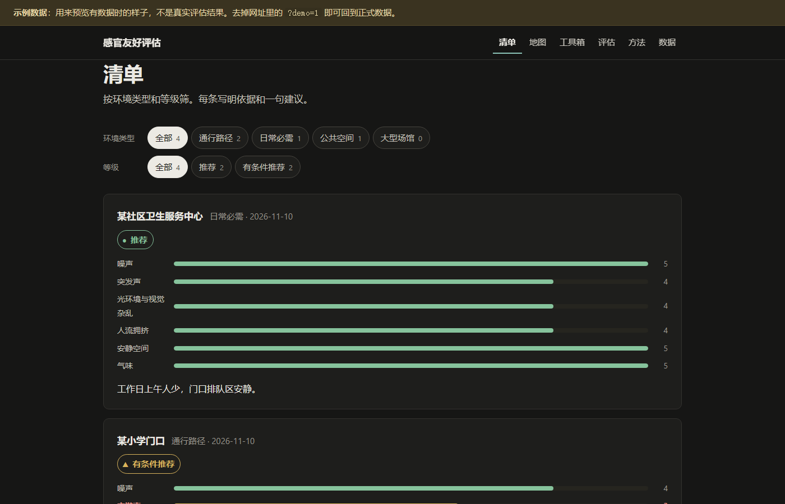

# 感官友好评估 · 海港区

线上地址 https://ginkgo2.github.io/



海港区公共场所的感官友好评估。六项观察，四项定级，按最弱的一项定级，不取平均。公开版只放推荐和有条件推荐，不推荐的点位不点名。

这是筛查工具，不是诊断，也不是声级计。

## 技术栈

- 原生 HTML、CSS、JS，无框架、无构建、无后端
- 数据写在 `data/points.js` 里
- 地图用 MapLibre，底图由 OSM 数据用脚本生成
- GitHub Pages 之类的静态托管

## 本地看

双击 HTML 就能看首页、清单、评估、方法和数据页。地图页要通过 http 或 https 打开，因为用 ES Module 和 WebGL。

```
python -m http.server 8000
```

然后打开 http://localhost:8000/

## 部署

1. 下载仓库，把站点根目录的文件推到自己的 GitHub 仓库根目录
2. 仓库 Settings 里打开 Pages，Source 选 Deploy from a branch，分支 main，目录选根
3. 等一两分钟，访问 https://用户名.github.io/ 或 https://用户名.github.io/仓库名/

链接都是相对路径，放在子目录也能用。Netlify、Cloudflare Pages 这类静态托管同样可以。

## 换城市

改 `scripts/map-config.mjs` 里的 BBOX，然后依次运行：

```
node scripts/fetch-map-data.mjs
node scripts/fetch-detail.mjs
node scripts/build-map.mjs
node scripts/build-detail.mjs
node scripts/build-geojson.mjs
```

抓数据需要能访问 Overpass API。点位坐标用 `map.html?pick=1` 取，点一下就能复制。

原始 OSM 数据不随仓库发布，只发布渲染出来的图和 GeoJSON。

## 采集到发布

```
data/places.csv     点位清单
raw/*.json          评估页导出的 JSON
node scripts/merge.mjs --places data/places.csv --raw raw --out data/points.js
```

合并脚本会校验分值越界、字段缺失、两人定级冲突。有错就不写文件，原数据保持原样。

## 许可

代码 MIT。点位数据 CC BY 4.0。底图由 OpenStreetMap 数据渲染，署名 © OpenStreetMap contributors，按 ODbL 1.0 使用。`data/demo-points.js` 只是预览用的示例。

## 限制

- 筛查工具，不能当医学结论
- 分贝计没有校准，只适合同一台手机前后比较
- 单次观察是快照，不覆盖天气和节假日
- OSM 在国内的校区、小区内部常常没有数据，底图会空
- 地图页依赖 WebGL，老设备可能打不开
